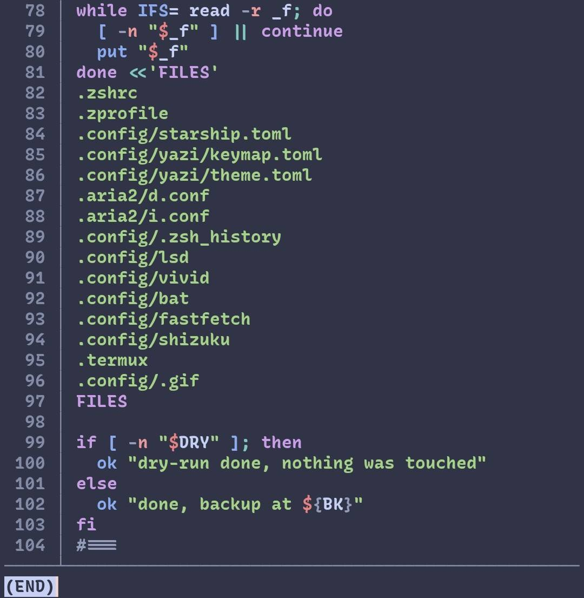
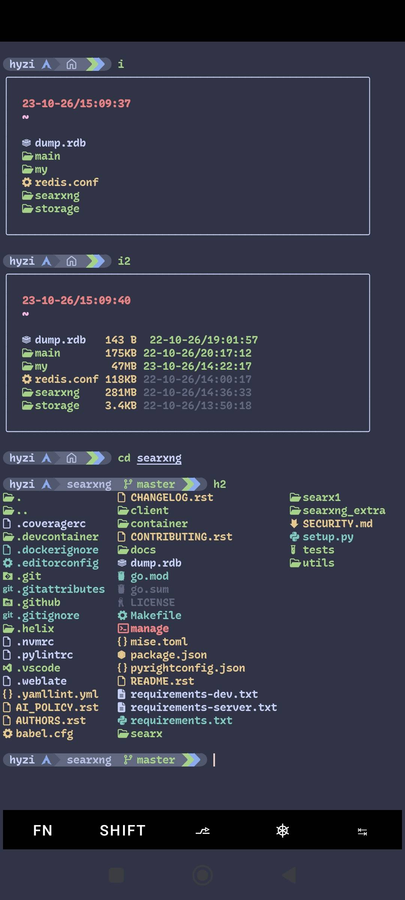
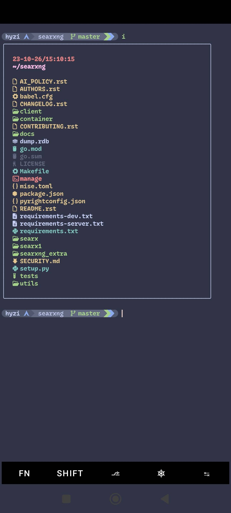
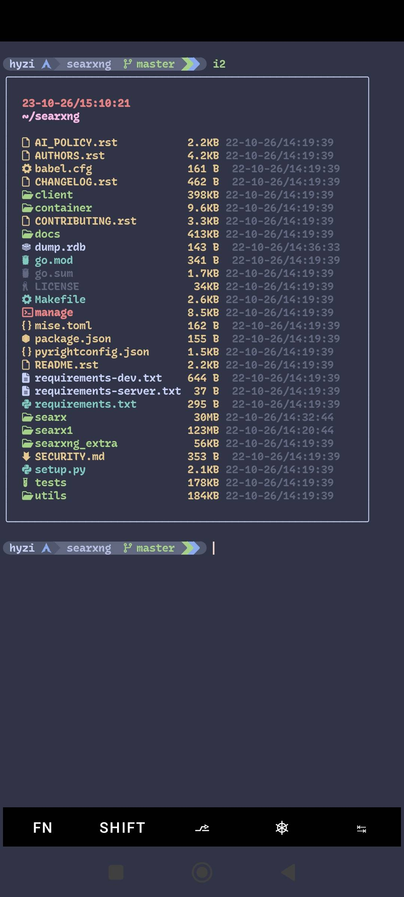
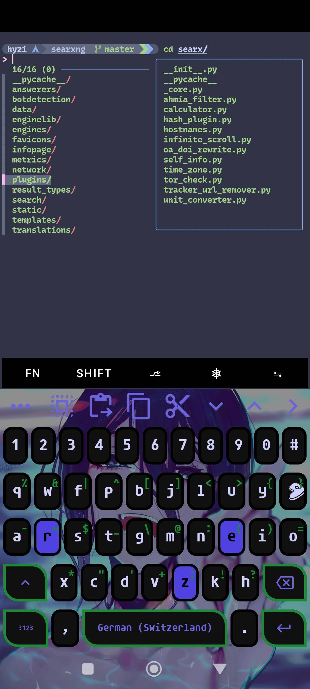
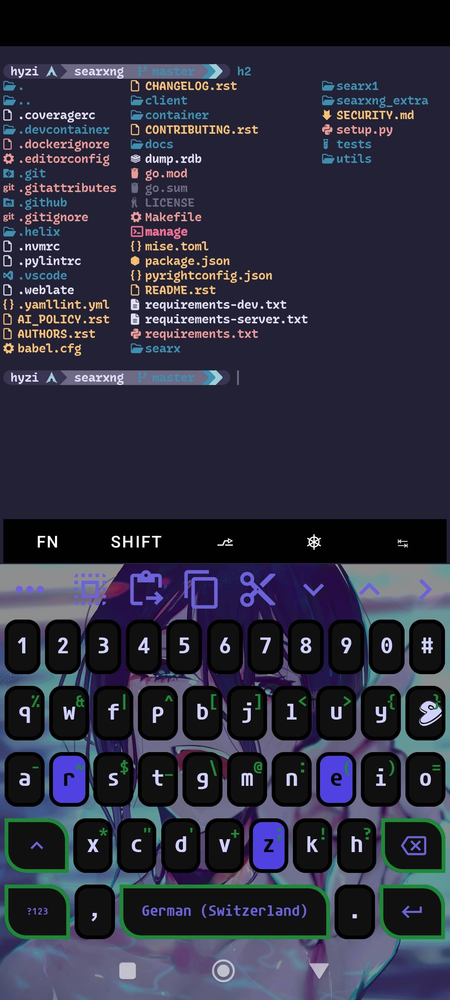
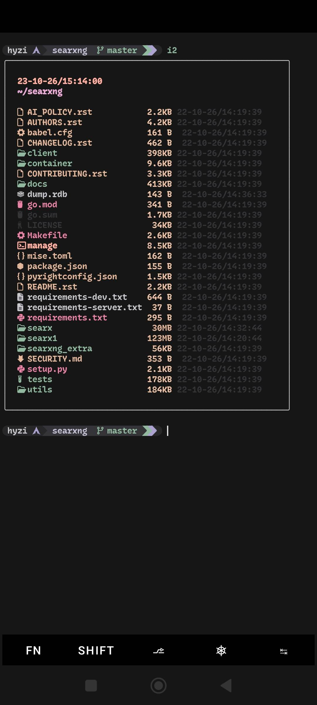
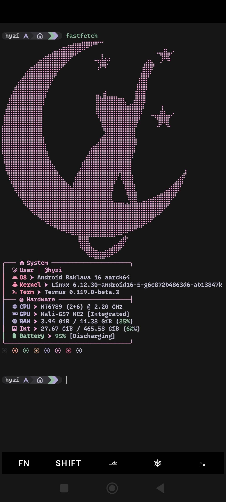
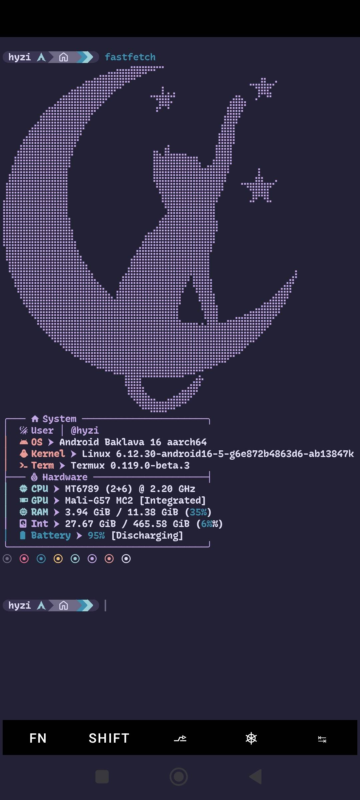
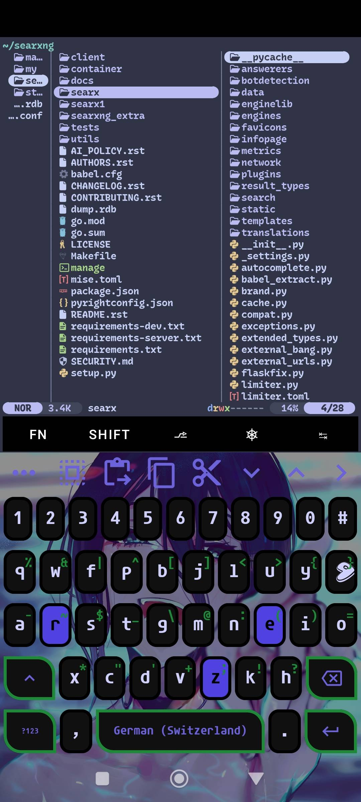

## Hi 🌿

I am very much a beginner in **programming** and in using **Git**. I will be uploading small projects I work on to get more familiar with these things. Please note that I use a **translator** to assist me, as my English is not yet very advanced.

<details>
  <summary>🪻 Files</summary>
  Early on, I adopted the habit—which I still maintain—of including comments (#) in my files: explaining why I added something and what its purpose is, noting its dependencies, and more. I imagine this will be a great help!
  </details>

## Update 💐

```git
git clone https://github.com/hyzi1/dotfiles-termux.git && cd hyzi
```

```chmod
chmod +x update.sh
```

```update
./update.sh
```

<details>
  <summary>🪻 Use</summary>
  To help you choose what you want, I’ve made it very easy to add or remove the items you wish to apply.
  <p align="center">
    
    </p>
  </details>

## Dependencies 🌹

In case you want a quick installation!

```plugins
chmod +x plugins.sh
```

```zsh
./plugins.sh
```

```pkg
pkg i zsh starship vivid file python git nodejs aria2 yt-dlp fzf zoxide lsd gum yazi ffmpeg neovim termux-api pinentry gnupg bat chafa fastfetch
```

```python
python3 -m pip install mutagen
```

## Demo 🌺

<p align="center">
  
  
  
  
  
  
  
  
  
  
  </p>

## Codeberg
[Codeberg](https://codeberg.org/hyzi/dotfiles-termux)

## Github
[Github](https://github.com/hyzi1/dotfiles-termux)

## Author
Created by **[hyzi]**.

## License
This project is licensed under the [MIT License](LICENSE).

If you use, adapt, or share anything from this project, please keep the original credits and link back to this repository.
