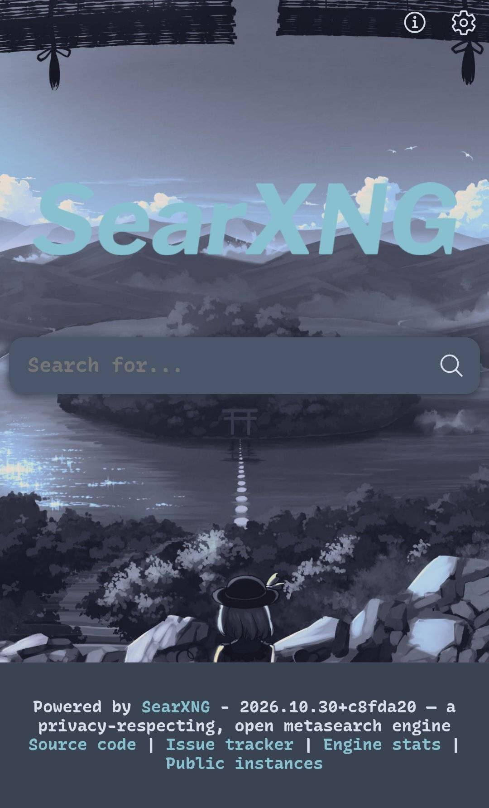
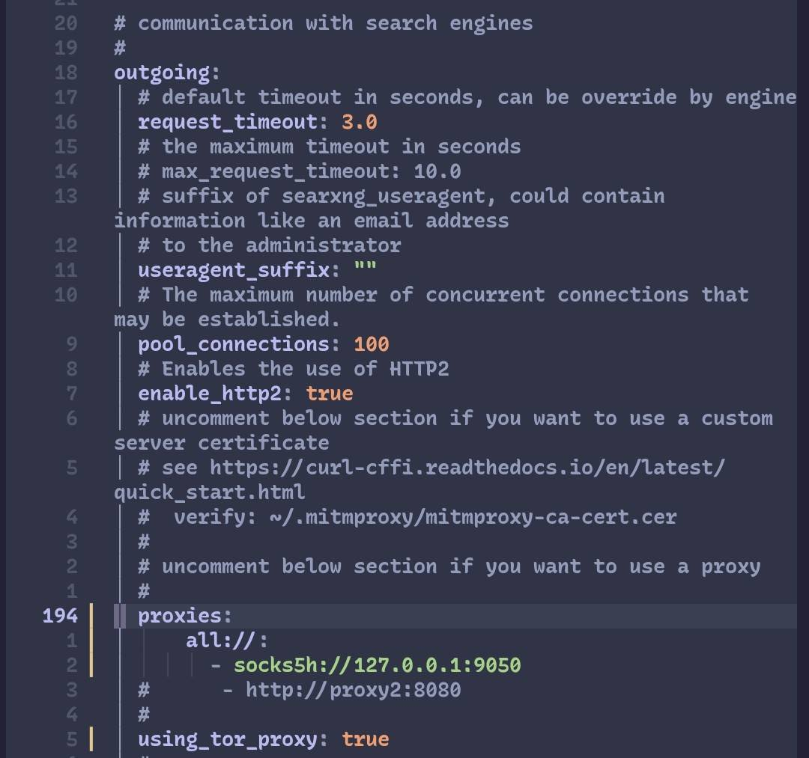
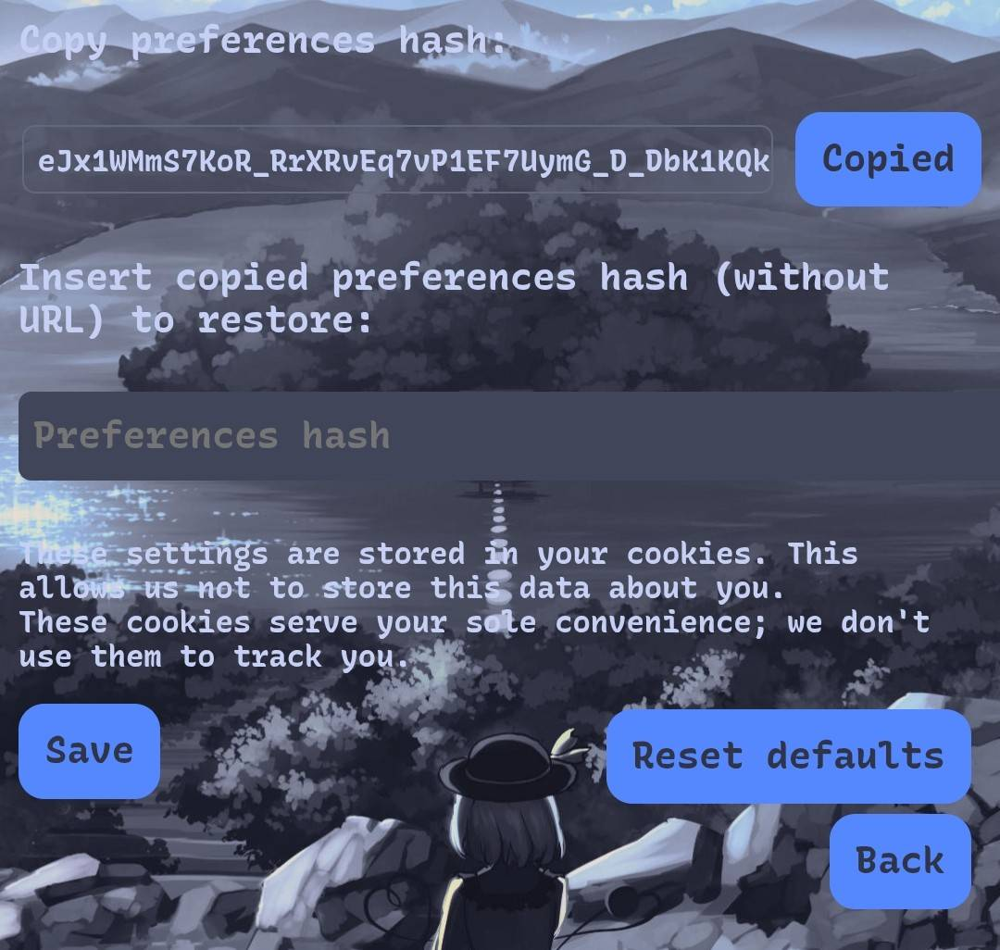

## SearXNG on Termux 🌺

<p align="center">
  
  </p>

SearXNG has become very important to me, as I use it daily. Consequently, I've taken some steps to speed up its installation and subsequent customization.

The script clones the SearXNG repository and installs the necessary dependencies. It then pulls the prebuilt stylesheets from the [PrivAu](https://github.com/privau/searxng) repository and patches three SearXNG files so its custom theme styles — dracula, nord, gruvbox, matcha, evergarden, kagi and more — can be picked straight from the web interface. It also generates a random `secret_key`, and appends a custom wallpaper and font to `sxng-ltr.min.css` if it finds them in `~/.config/.searxng/`. If nothing is found, the installation proceeds as usual.

You can re-run the script at any time to apply a new wallpaper or font. Since it checks for existing files, it can also be used simply to update them, and nothing is ever duplicated. Wallpapers are identified by their file extension — `.jpg`, `.png` or `.jpeg`, case-insensitive — while fonts are expected in `.ttf` format; both settings are easy to modify within the script itself. Although it is a fairly basic script, it is worth highlighting.

## Install 💐

If you want a wallpaper and a custom font, set up the folder first:

```bash
mkdir -p ~/.config/.searxng
```

Drop your files there — the script looks for these exact names:

| File | Purpose | Accepted formats |
| --- | --- | --- |
| `img.jpg`, `img.png` or `img.jpeg` | interface wallpaper | `.jpg`, `.png`, `.jpeg` |
| `font.ttf` | interface font | `.ttf` |

Then run the installer:

```bash
wget https://raw.githubusercontent.com/hyzi1/dotfiles-termux/main/searxng/searxng-i.sh
chmod +x searxng-i.sh
./searxng-i.sh
```

Finally, install the launcher:

```bash
wget https://raw.githubusercontent.com/hyzi1/dotfiles-termux/main/searxng/searx
chmod +x searx
mv searx $PREFIX/bin/
```

## Use 🌹

Start the instance:

```bash
searx
```

Then open `http://127.0.0.1:8888` in your browser. Press `Enter` to stop the instance.

To pick a theme style, go to **Preferences >> Interface >> Theme style** and choose between dracula, nord, gruvbox, matcha, evergarden and the rest — remember to save.

To change the wallpaper or the font later, replace the files in `~/.config/.searxng/`, re-run `./searxng-i.sh` and restart the instance.

## Notes 🪻

- Re-running the script is safe: it rebuilds the stylesheet and re-applies your wallpaper and font without duplicating anything.
- Your `secret_key` is generated on the first run and preserved on every re-run.
- If SearXNG's upstream ever changes the files this script patches, it fails loudly instead of leaving you with a broken interface.

## Onion 🌱 

To prevent service providers from seeing your IP address, you can use a **VPN**, **Orbot** in **proxy mode**, or any other method you prefer. If you choose not to use any such tool, you can simply proceed as is; while providers will be able to see **your IP address, there will be no actual tracking.**

If you would like to use **Orbot** as a **proxy**, I can show you how—though, as you likely know, there are well-known issues regarding how IP addresses from the Tor network are typically treated.

```onion
vim ~/searxng/searx/settings.yml
```

<p align="center">
  
  </p>

And also look for and activate: `image_proxy: true`

## Hash

Select only what you truly need; otherwise, **SearXNG** might not function correctly. In my case, the results are the same as when I use those providers directly—outside of SearXNG—since I only use **Google** (or, occasionally, **Yahoo**) for web searches, and **Google** for image searches. I will also include the **hash** of my configuration settings here.
[Hash](./hash.txt)

<p align="center">
  
  </p>

## My plan

My plan is to populate this repository with my progress in programming, Linux, and Git, using Termux. I’ll be uploading all sorts of things—like this section on SearXNG.
